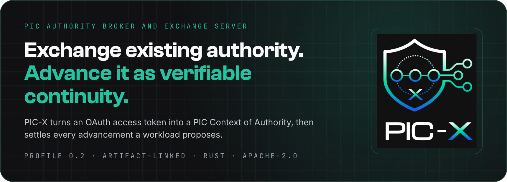

<p align="center">
  
</p>

<p align="center">
  <a href="https://www.pic-protocol.org/pic-x"><b>Website</b></a> ·
  <a href="#run-pic-x"><b>Run it</b></a> ·
  <a href="#run-the-lab"><b>Lab</b></a> ·
  <a href="docs/continuity-design.md"><b>Continuity design</b></a> ·
  <a href="https://github.com/pic-protocol/pic-spec"><b>PIC Specification</b></a>
</p>

# PIC-X

## What PIC-X Is

PIC-X is the official PIC Authority Broker and Exchange Server. Its current Profile 0.2 path
preserves verifiable, artifact-linked authority continuity: PIC-X derives, verifies and advances the
authority represented by signed lineage artifacts and executor-profile evidence. It does not yet
claim that those artifacts prove an observed runtime handoff, request/channel continuity, complete
mediation or causal attribution; those require the planned trusted Execution Context boundary.

As an Authority Broker, PIC-X maps upstream credentials into PIC Contexts of Authority while keeping
provenance, constraints, privileges and audit material explicit. As an Exchange Server, it exposes
the protocol surface where source tokens and continuity proposals are exchanged for PIC Tokens that
downstream verifiers can check.

## How It Works

<p align="center">
  
</p>

A realm is an issuer with its own signing keys, audit trail and pseudonymisation.
Its token endpoint takes an OAuth access token through [RFC 8693](https://www.rfc-editor.org/rfc/rfc8693) token exchange, maps it into the origin PIC Context of Authority, and returns the first settled PIC Token JWT.
From then on, a workload that continues the execution signs exactly one candidate transition and presents issuer-signed executor-profile evidence bound to its key.
At settlement, PIC-X verifies that:

1. the predecessor checkpoint was signed by the realm and has not reached its absolute expiry;
2. the candidate token, Continuity COSE and Transition COSE are structurally consistent;
3. the SD-JWT comes from a configured attester and binds the candidate signing key;
4. the disclosed executor-profile claims satisfy every constraint of the predecessor execution contract;
5. authority only attenuates, while execution-contract constraints only accumulate;

and then signs the new checkpoint and audits it synchronously before releasing the next PIC Token.
The successor is never named in advance: a publisher may write to a queue without knowing which worker will consume, so several independently keyed workers may each advance the same checkpoint as separate branches.
The PIC artifacts are built and signed with the [`pic-protocol`](https://crates.io/crates/pic-protocol) crate from [pic-rust](https://github.com/pic-protocol/pic-rust).

## What It Guarantees Today

PIC-X advertises its assurance level in discovery, as `pic_continuity.continuity_evidence_levels_supported = ["artifact-linked"]`.
That level is a partial implementation class defined by the PIC Specification; it is not full PIC continuity.

| Property | Status |
| --- | --- |
| Signed artifact lineage, exactly one predecessor reference | Implemented |
| Authority attenuation; removed entries cannot be reintroduced | Implemented |
| Additive execution-contract refinement and executor-profile conformance | Implemented |
| Trusted-issuer executor-profile evidence bound to the workload key | Implemented |
| Unknown successor and sibling fan-out | Implemented, intentionally |
| Semantic `PoR(s_i, s_{i+1})` for an observed handoff | Partial: no trusted observation of the handoff yet |
| Request binding and transport or channel continuity | Not implemented |
| Complete mediation and causal attribution of protected actions | Not implemented by PIC-X |
| Per-lineage early revocation | Deferred: absolute expiry and key retention are the current bounds |

In one sentence: PIC-X excludes authority mixing by construction within a validated artifact lineage, and enforces executor-profile conformance at each settled advancement.
It does not prove an observed causal handoff, bind the transport request, or provide complete mediation; those need the trusted Execution Context described in [docs/continuity-design.md](docs/continuity-design.md).

## Start Here

PIC-X is a local-first Rust service with three surfaces: public discovery, administrative gRPC and
telemetry. The repository exposes the same workflows through `Makefile` and `Taskfile.yml`; use
whichever runner you already have. The examples below use `make`.

### Requirements

| Tool | Why | Install |
| --- | --- | --- |
| Rust 1.97+ | Build and run PIC-X locally | <https://rustup.rs/> |
| Make or Task | Run project workflows | Make is usually already installed; Task: <https://taskfile.dev/installation/> |
| Docker | Run the lab stack | <https://docs.docker.com/get-docker/> |
| Python 3 | Run the lab demo script | <https://www.python.org/downloads/> |
| grpcurl | Exercise the admin gRPC endpoint | <https://github.com/fullstorydev/grpcurl> |
| curl | Call HTTP endpoints from the shell | Usually already installed |

See every available workflow with:

```sh
make help
```

## Run PIC-X

```sh
make run-as-local
```

This starts the local development config, creates `.volume/`, writes a file audit trail, creates the
pseudonymisation secret and maintains a signing key ring. It stays on loopback and uses plain HTTP so
the first run is boring in the best possible way.

```sh
curl http://127.0.0.1:7556/
curl http://127.0.0.1:7556/.well-known/server-configuration
curl http://127.0.0.1:7558/healthz
```

The admin surface is gRPC:

```sh
grpcurl -plaintext \
  -import-path crates/pic-x-admin/proto -proto picx/admin/v1/admin.proto \
  localhost:7557 picx.admin.v1.Admin/GetVersion
```

For the TLS and mTLS local profile:

```sh
make run-as-local-tls
```

```sh
curl --cacert .volume/tls/ca.pem https://localhost:7556/.well-known/server-configuration
grpcurl -cacert .volume/tls/ca.pem \
  -cert .volume/tls/client.pem -key .volume/tls/client.key \
  -import-path crates/pic-x-admin/proto -proto picx/admin/v1/admin.proto \
  localhost:7557 picx.admin.v1.Admin/GetVersion
```

## Container Image

Published images are available from GitHub Container Registry:

<https://github.com/pic-protocol/pic-x/pkgs/container/pic-x>

```sh
docker pull ghcr.io/pic-protocol/pic-x:0.2
```

The image entry point is `pic-x`; the command is the config path. The image ships no configuration:
write yours by copying from [config.template.yml](config.template.yml), then mount it:

```sh
docker run --rm --init \
  --publish 7556:7556 --publish 7557:7557 --publish 7558:7558 \
  --volume "$PWD/my-config.yml:/etc/pic-x/config.yml:ro" \
  --volume "$PWD/pic-x-state:/var/lib/pic-x" \
  ghcr.io/pic-protocol/pic-x:0.2
```

For volume contents, TLS material and production requirements, see [docs/docker.md](docs/docker.md).

## Run The Lab

The lab is the fast path for seeing the moving pieces together:

- Keycloak with an imported example realm: <http://localhost:18080/>
- PIC-X built from this checkout and run with [config.lab.yml](config.lab.yml): <http://localhost:17556/>
- A tiny public Rust API built from [trust-lab/](trust-lab/): <http://localhost:17080/>

Everything is HTTP-only and bound to `127.0.0.1`, so there is no certificate setup and nothing is
published to your network. The first `lab-up` builds the local PIC-X and trust-lab images, so it can
take a few minutes.

```sh
make lab-up
make lab-demo
make lab-down
```

The demo starts with an ASCII flow map, checks that the three services are reachable, gets a token
from the example IdP and prints the next step the exchange flow will grow into. It uses terminal
colors automatically; set
`LAB_DEMO_COLOR=never` if you need plain output. A healthy run starts like this:

```text
:: PIC-X local trust lab demo
-----------------------------
local | docker compose | example IdP | public API

A short local run through IdP, PIC-X and the public trust API.
No cloud account. No TLS ceremony. Just the path we will extend into exchange.

Flow map
--------
  current demo
  +----------------+   password grant    +------------------------+
  | lab-demo       | -------------------> | Keycloak example IdP   |
  | local script   | <------------------- | localhost:18080        |
  +----------------+    access token      +------------------------+
          |
          +---- discovery check --------> +------------------------+
          |                               | PIC-X localhost:17556  |
          |                               +------------------------+
          |
          +---- verify trust deps -------> +------------------------+
                                          | Trust Lab public API   |
                                          | localhost:17080        |
                                          | no auth yet            |
                                          +------------------------+

  target flow
  Keycloak token -> pic_context_of_authority exchange
     -> node A -> node B -> node C
     each node emits profile/key evidence + an artifact-linked continuity candidate

[1] Checking lab services (up to 30s)
    OK  Keycloak IdP: http://localhost:18080/realms/acme-idp
    OK  Trust Lab API: public trust lab API
    OK  PIC-X public API: PIC-X 0.1.0

[2] Requesting a token from the example IdP
    realm: acme-idp
    client: acme-idp-client
    user: alice
```

Useful lab commands:

```sh
make lab-get-idp-config
make lab-get-idp-jwt
curl -fsS http://localhost:17080/
curl -fsS http://localhost:17556/.well-known/server-configuration
```

## Surfaces

| Surface | Default port | Purpose | Intended access |
| --- | --- | --- | --- |
| Public | 7556 | Discovery documents and JWKS | Clients and verifiers |
| Admin | 7557 | gRPC operations that change state | Named operators, preferably over mTLS |
| Telemetry | 7558 | `/healthz`, `/readyz`, `/metrics` | Probes and collectors |

The ports are separate so administration is not accidentally exposed through the public surface.

## Operator Docs

| Need | Read |
| --- | --- |
| Start locally, with TLS, in docker, or in the lab | [docs/start-server.md](docs/start-server.md) |
| Run the image and understand the volume | [docs/docker.md](docs/docker.md) |
| Run the local Keycloak and public REST lab | [docs/keycloak.md](docs/keycloak.md) |
| Verify and operate the audit trail | [docs/audit.md](docs/audit.md) |
| Understand current continuity guarantees and the Execution Context roadmap | [docs/continuity-design.md](docs/continuity-design.md) |
| Back up and restore the volume | [docs/backup-and-restore.md](docs/backup-and-restore.md) |
| Use the workflow shortcuts | [docs/tasks.md](docs/tasks.md) |

## Config Files

| File | Use |
| --- | --- |
| [config.local.yml](config.local.yml) | Local development, no TLS, loopback only; used by `make run-as-local` |
| [config.local-tls.yml](config.local-tls.yml) | Local development with TLS and mTLS; used by `make run-as-local-tls` |
| [config.docker.yml](config.docker.yml) | Single container, no TLS; mounted by `make run-as-docker` |
| [config.docker-tls.yml](config.docker-tls.yml) | Single container with TLS and mTLS; mounted by `make run-as-docker-tls` |
| [config.lab.yml](config.lab.yml) | Docker Compose lab config for the PIC-X container |
| [config.template.yml](config.template.yml) | Full annotated reference, and what a production config is copied from |

Runtime values are layered: defaults, build metadata, config file, environment, then CLI flags. A CLI
flag such as `--log-level trace` wins over `PIC_X_LOG_LEVEL`, which wins over `log.level` in the file.

## Development

```sh
make help
make check
make test
make lab-up
make lab-get-idp-config
make lab-get-idp-jwt
make lab-demo
make lab-down
make run-as-docker
```

`make check` is the local CI gate: clippy with warnings denied, architecture checks, supply-chain
checks and the test suite.

## Learn

Articles:

- <a href="https://www.ngallo.it/blog/2026-08-01/pic-x-from-spec-to-arch/" target="_blank" rel="noopener noreferrer">Designing PIC-X: From Specification to Architecture to Code</a>
- <a href="https://www.ngallo.it/blog/2026-08-01/pic-x-exchanging-token-to-pca/" target="_blank" rel="noopener noreferrer">Designing PIC-X: Deriving an Initial PIC Context of Authority</a>
- <a href="https://www.ngallo.it/blog/2026-08-01/pic-x-well-known-config/" target="_blank" rel="noopener noreferrer">Designing PIC-X: Exposing Configuration through .well-known/pic-x-configuration</a>
- <a href="https://www.ngallo.it/blog/2026-08-11/pic-x-token-types-jwts/" target="_blank" rel="noopener noreferrer">Designing PIC-X: PIC Token JWT and COSE Artifacts</a>
- <a href="https://www.ngallo.it/blog/2026-08-14/pic-x-centralized-token-exchange/" target="_blank" rel="noopener noreferrer">Designing PIC-X: Centralized Token Exchange End to End</a>

## License

Apache-2.0. See [LICENSE](LICENSE).
